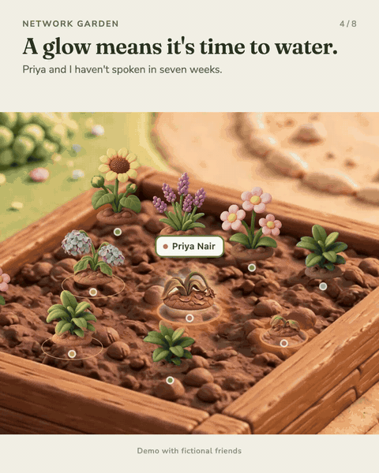

# Network Garden

**You can't pick fruit from a wilted flower.**

Most of us only reach out to our network when we need something. Network Garden turns your network into a garden so you can see, at a glance, who you haven't spoken to in too long, and water those friendships before you need them.

<p align="center"></p>

## Try it

- **Demo with fictional friends:** https://austinzhang12345.github.io/network-garden/
- **Start your own garden:** https://austinzhang12345.github.io/network-garden/garden.html. It starts empty and saves to your own browser.

Both are single HTML files. No account, no server, no install.

## How it works

- **Every person is a plant.** Strong ties, weak ties and new faces each get their own bed. The garden holds 20 plants; everyone else rests in the nursery.
- **Plants tell you who needs care.** Each friend has a care rhythm (every 30 days, say). Past it, the plant starts to droop. At 1.5 times the rhythm it wilts and glows.
- **Log a real moment in one tap.** A message, a coffee, an intro or a bit of help waters the plant and it blooms again.
- **Growth never resets.** A quiet month doesn't erase a good relationship. Shared history only adds up.
- **One table underneath.** The List view shows everyone sorted by who needs you most: company, role, when you first connected, what they can offer you and what you can offer them.

Shortcuts: `G` garden, `L` list, `J` journal, `N` new friend, `/` find.

## Privacy

Your garden lives in your browser's local storage. Nothing is sent anywhere. Use **Export backup** to keep a copy, and **Restore** to move it to another browser.

## Build from source

Requires Node 18 or later.

```bash
node build.mjs
node --test model.test.mjs
```

`build.mjs` inlines the styles, scripts and images into `docs/index.html` (demo) and `docs/garden.html` (empty garden).

| File | What it is |
|---|---|
| `index.html` | Page template |
| `app.js` | Interface: garden, list, journal, drawer, storage |
| `model.mjs` | Care rules, growth, garden layout, backups |
| `model.test.mjs` | Tests for the model |
| `styles.css`, `layout-tweaks.css` | Styles |
| `assets/` | Clay garden background, signs, panda, butterflies and 21 plant sprites (7 plants x 3 care states) |
| `tools/normalize_plants.py` | Aligns plant sprites to one frame so a plant never jumps when its state changes |

## Built with

Claude Code, Codex and Muse, by Austin Zhang, who doesn't come from a tech background. This is version 31 and still a work in progress. Ideas and feedback are welcome in Issues.
